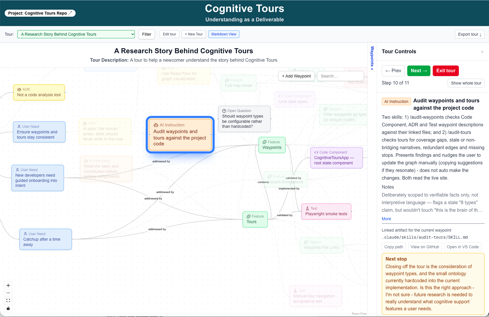

# Cognitive Tours

**Maps and guided tours of your code that you write yourself, linking why to how.**

**[Try the demo](https://cognitive-tours-demo.vercel.app)** · [Install](#install) · [Quick start](#quick-start) · [Things to try](#things-to-try) · [The research](#the-research)

[](https://cognitive-tours-demo.vercel.app)

## Why

- **Code outruns understanding.** With AI writing more of it, teams ship code nobody fully understands, and lose track of *why* it is the way it is (cognitive debt and intent debt).
- **Writing the tour is how you get it back.** You place waypoints (goals, needs, decisions, code, tests, risks, open questions), connect them, and write guided tours that walk from why to how. Tours you write yourself rebuild your own understanding; tours you share pass some of it on.
- **AI is a scaffold, not a substitute.** Claude Code skills can draft a starting map or ask you the right questions, but the understanding stays yours.

**Status:** a research prototype, built by its author with AI assistance (Claude Code), and used on itself: the map and tours describe how it was built. Feedback and ideas are welcome.

## Try it in two minutes, no install

- **[The demo](https://cognitive-tours-demo.vercel.app):** a real map, of Cognitive Tours itself. Click **Start here** for a one-minute walkthrough, then pick **"A Research Story Behind Cognitive Tours"** and step through it. Anyone can edit it; it resets every hour.
- **A sandbox of your own** to write waypoints and tours: ask the author for one.

More in **[Getting started](docs/GETTING-STARTED.md)**, including a map of Flask, a codebase the author didn't write.

## Install

The Claude Code plugin **cognitive-tours** works in any repo. In your terminal:

```
claude plugin install cognitive-tours --marketplace margaretstorey/cognitive-tours
```

Then restart Claude Code. Details, other ways to install, and updating: [Skills for Claude Code](#skills-for-claude-code).

## Quick start

1. Open your repo in Claude Code.
2. Ask: **"Make a starting map of this repo."** The first time, use the full command from your site's **Claude Code skills** button, which tells the skill which map is yours; it offers to remember it.
3. Read the drafted map on your site, then rewrite it in your own words: it's marked as drafted by Claude until you do.

## Things to try

| Ask Claude Code | On the map |
|---|---|
| "Make a starting map of this repo" | Click **Start here** for the walkthrough |
| "Help me record what I just did" | Pick a tour and step through it with **Next** |
| "Add this to a tour" | Open a stop's file in VS Code or on GitHub |
| "Is my map out of date with the code?" | Write the bridge from one stop to the next in **Edit tour** |
| "Which of my tours are stale?" | Filter by layer (intent, technical) to see one view of the map |

## The research

- [From Technical Debt to Cognitive and Intent Debt](https://arxiv.org/abs/2603.22106) (Storey, 2026), the research foundation.
- [*Cognitive Tours: Making Understanding a Deliverable in AI-Assisted Development*](https://arxiv.org/abs/2611.08456) (arXiv, 2026), a longer version of the ICSE 2027 demo paper, which is under review.
- [An early demo video](https://www.youtube.com/watch?v=I2S5Ee3bzi8) (4 min, Oct 23, 2026); newer walkthroughs coming soon.

**Domains:** cognitive.tours | cognitivetours.dev

---

## What it does

Cognitive Tours lets you place waypoints on an interactive graph — each 
waypoint is a meaningful place in your project: a user need, a design 
decision, a risk, a key component, a test, or an open question. You then 
connect waypoints into guided tours that tell the story of your codebase.

The app is self-documenting: the waypoints and tours in the live app 
describe Cognitive Tours itself.

Tours support **docent mode** — per-step narrative written by the tour author 
that guides the reader between waypoints, like a museum audio guide. Tours can 
also be toggled to a **markdown view** and exported as dated snapshots to the 
`tours/` folder. The graph panel has a **search/filter bar** to find nodes 
quickly as the map grows.

---

## Ontology (in progress!)

Waypoints are typed - and for now hardcoded.  Edges are not typed.
Waypoints can be of type: Goal, User need, feature, ADR, risk, open question, code components
Tours link waypoints according to a goal (name of the tour)

---

## Skills for Claude Code

A Claude Code plugin, **cognitive-tours**, bundles five skills that work in
any repo. Install it once, **in your terminal**:

```
claude plugin install cognitive-tours --marketplace margaretstorey/cognitive-tours
```

or **inside Claude Code** (at Claude's prompt, not the shell's):

```
/plugin install cognitive-tours --marketplace margaretstorey/cognitive-tours
```

(Older Claude Code: `/plugin marketplace add margaretstorey/cognitive-tours`,
then `/plugin install cognitive-tours@cognitive-tours`.) Restart any open
Claude Code session to pick up the skills. To get a newer version later:
`claude plugin update cognitive-tours`.

You don't have to remember the commands: ask Claude Code in your own words,
such as "make a starting map of this repo", "help me record what I just
did", "add this to a tour" or "which of my tours are stale?", and it picks
the right skill.

- **`/cognitive-tours:first-tours site <url>`**: no blank page on a repo you
  don't know yet. It reads the repo and, after you OK the plan, adds a
  starting map: about a dozen waypoints and two short tours (the user's view
  and the builder's view), marked as drafted by Claude for you to check and
  rewrite. An empty map's **Copy command** button gives you this command
  with the site filled in.
- **`suggest-waypoint`, `suggest-tour`**: ask you questions so you record
  recent work as waypoints and tours in your own words.
- **`audit-waypoints`, `audit-tours`**: report where the map has drifted from
  the code.

Try it on a blank sandbox of your own (ask the author for one).
Details in [docs/GETTING-STARTED.md](docs/GETTING-STARTED.md#3-the-ai-skills-claude-code).
The plugin's files are in [`plugins/cognitive-tours/`](plugins/cognitive-tours/).

---

## Running your own instance
See [SETUP.md](./SETUP.md) for instructions on cloning this to run against your own database and project.

## Running locally

```bash
git clone https://github.com/margaretstorey/cognitive-tours
cd cognitive-tours
npm install
npx prisma generate
npx prisma migrate dev
npm run dev
```

Open http://localhost:3000.

### Environment variables

To connect to the shared Turso database, 
create a `.env.local` file:

TURSO_DATABASE_URL=your-turso-url

TURSO_AUTH_TOKEN=your-turso-token

Contact Margaret-Anne for the credentials.

**Note:** The shared database has no conflict protection. If two people 
edit simultaneously, changes can overwrite each other silently. Coordinate 
with Margaret-Anne before making significant changes, and back up `/api/data` 
first. Alternatively, create your own Turso database at turso.tech for 
isolated local development.

The app uses SQLite locally via Prisma. The production deployment uses 
Turso (hosted SQLite) on Vercel.

---

## Architecture

- **Next.js 16 + TypeScript + Tailwind + React Flow**
- **Three-panel layout:** graph (left), waypoint detail (right), tour bar (top)
- **Persistence:** SQLite + Prisma locally, Turso in production
- **State:** single root component `CognitiveToursApp.tsx` owns all app state

See `CLAUDE.md` for the full project state, key decisions, and backlog.

---

## Contributing

**If you are a new collaborator, start here:** open the demo and follow 
the tours before reading any code. "A Research Story Behind Cognitive Tours" 
explains the research motivation, and "Architecture of the Cognitive Tours 
App Code" walks through the code. The app is self-documenting: the tours are 
the onboarding.

Read `CLAUDE.md` before touching any code. It is the cognitive layer — the 
bridge between intent, understanding, and code.

This project uses a two-Claude workflow: one Claude instance handles 
planning and architecture (working from CLAUDE.md), another handles 
implementation via Claude Code. If you are contributing as a developer, 
start Claude Code from the repo root and it will read CLAUDE.md 
automatically.

**Note for collaborators:** Before making significant changes, visit 
/api/data and save the JSON as a backup. There is no undo.

The constitution (8 principles) lives at `.specify/memory/constitution.md`. 
Read it before adding any feature.

## License

MIT. See [LICENSE](LICENSE).
